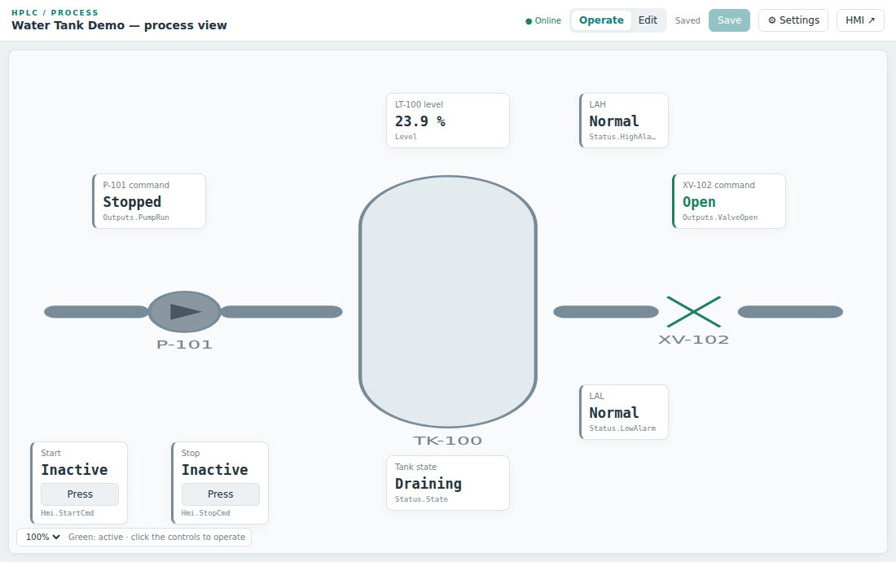
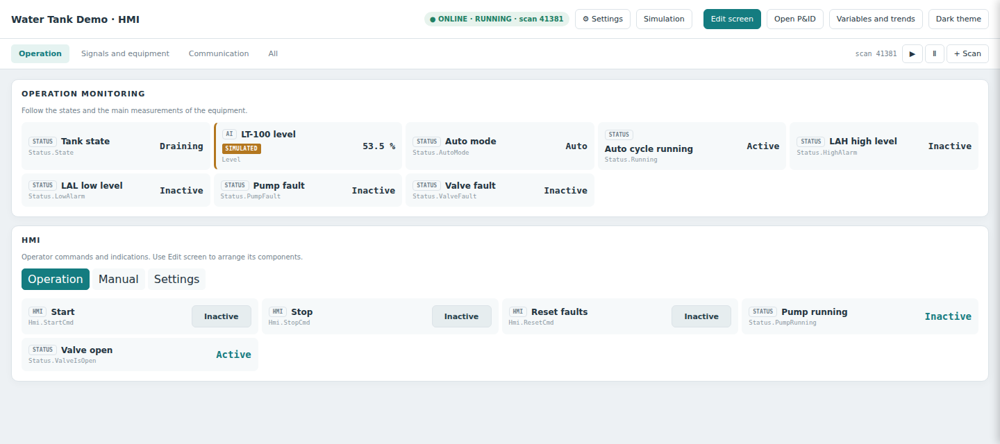
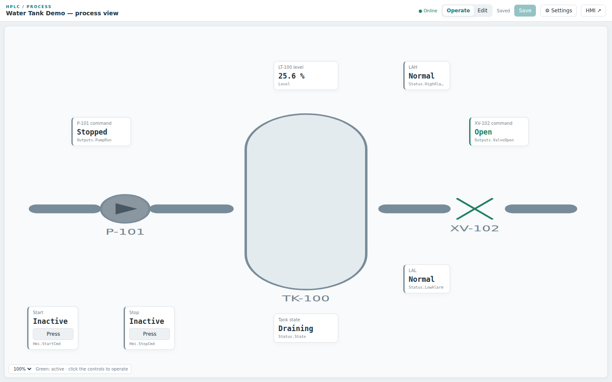
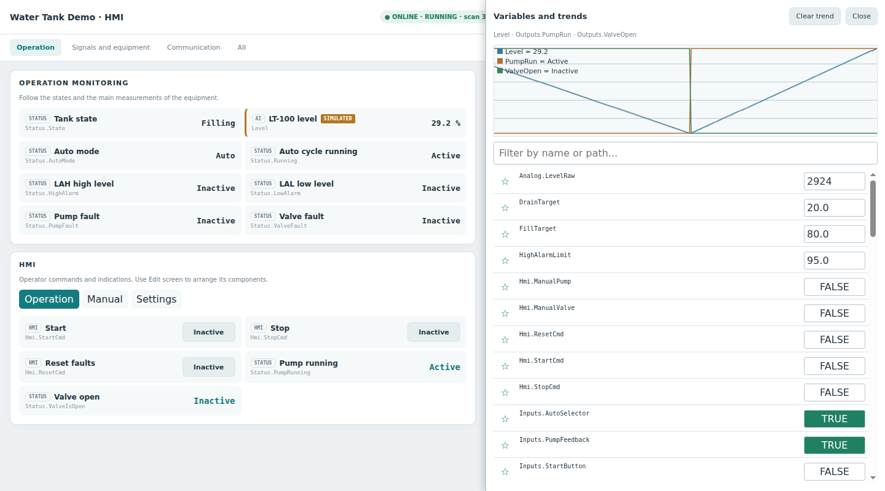
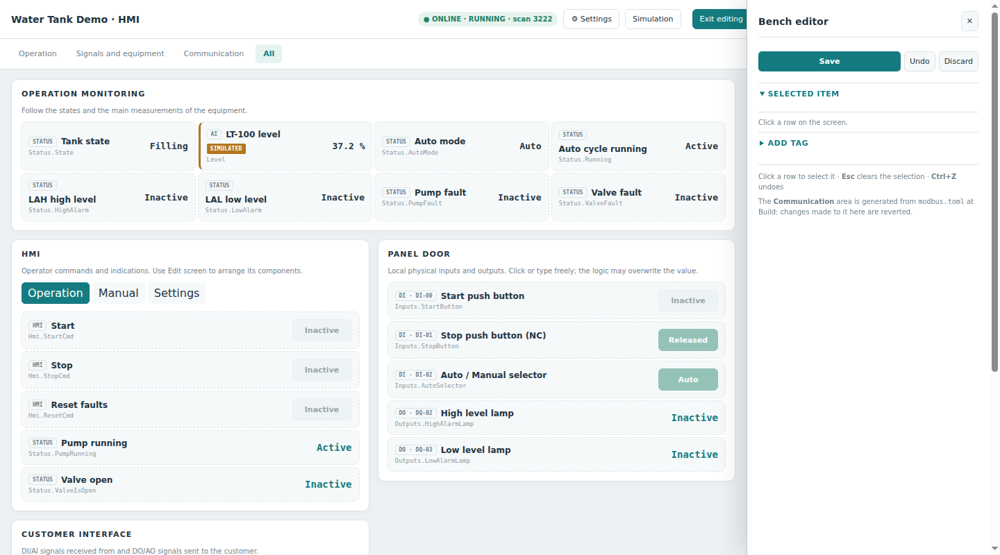
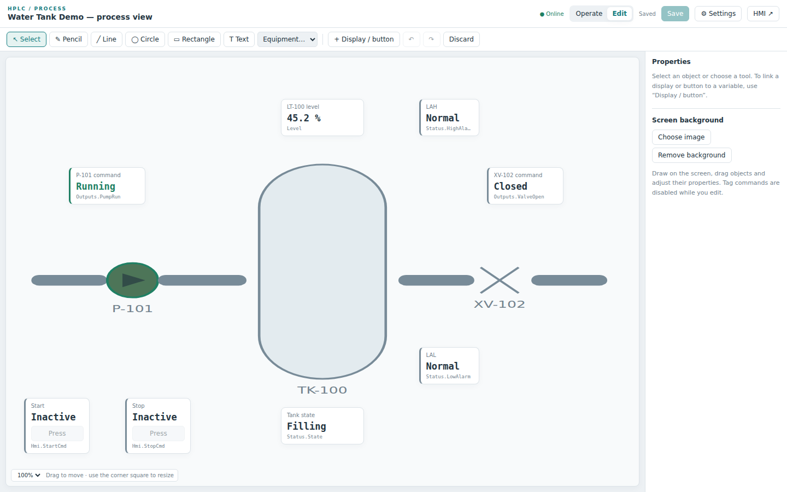
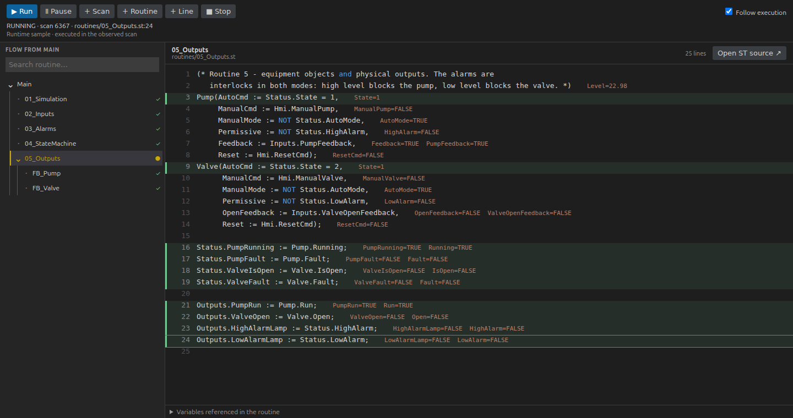

# HPLC — PLC simulator for VS Code

[](LICENSE)
[](https://code.visualstudio.com/)
[](https://en.wikipedia.org/wiki/IEC_61131-3)
[](#requirements)

HPLC is a VS Code extension that turns a folder of IEC 61131-3 **Structured Text** into a
soft-PLC that really runs. It compiles your program, executes it with a fixed scan time,
and serves an operator **HMI** and a **P&ID** view in the browser. You can also step
through the code live and force variables.

It reads **PLCopenXML** exported from your PLC IDE, so you can test the real program away
from the machine. It writes PLCopenXML back, either as a byte-faithful update of the
original project or as portable logic for any IEC IDE.



<sub>The water-tank example running in HPLC (time-lapse, 5×).</sub>

> **Status:** HPLC is used daily for engineering and commissioning tests. It is a
> **simulator for engineering**. It is not a controller, and it must never drive real
> equipment.

---

## Contents

- [What you can do](#what-you-can-do)
- [Requirements](#requirements)
- [Installation](#installation)
- [Quick start](#quick-start)
- [Project layout](#project-layout)
- [Importing from your PLC IDE](#importing-from-your-plc-ide)
- [Running, HMI and P&ID](#running-hmi-and-pid)
- [Live code and debugging](#live-code-and-debugging)
- [Exporting back to the IDE](#exporting-back-to-the-ide)
- [Working with an AI assistant (recommended)](#working-with-an-ai-assistant-recommended)
- [Settings and language](#settings-and-language)
- [Limitations](#limitations)
- [Roadmap](#roadmap)
- [Building from source](#building-from-source)
- [License](#license)

---

## What you can do

- **Import** a PLCopenXML project. ST is kept as is; Ladder and FBD networks are converted
  to ST, including edges, EN/ENO and the standard functions. Initial values, RETAIN,
  PERSISTENT and CONSTANT qualifiers, arrays and structs are preserved.
- **Simulate** the program with a fixed-period scan, using the same tasks and cycle time
  declared in the XML.
- **Operate** it from an HMI page (buttons, switches, lamps, numeric fields) and watch it
  on a P&ID page (tank, pump, valve, pipes) in any browser or inside VS Code.
- **Debug** live: pause, step one scan, one routine or one line, see executed lines and
  values in the code, and force or write variables.
- **Export** the project:
  - **Full**: the original vendor XML, edited only where you changed something, ready to
    import back into the same project;
  - **Logic only**: plain ST, as `_Application.xml` plus one `.st` file per POU.
- **Test** behaviour with scenario files (`tests/scenarios.yaml`).

## Requirements

| | |
|---|---|
| OS | **Ubuntu 22.04+** (native or under **WSL2 on Windows**). Other Linux distributions with the same tools should work but are not tested. |
| VS Code | 1.85 or newer |
| Compiler | `g++` with C++17 (`build-essential`) |
| Python | `python3` (3.10+; standard library only) |
| ST compiler | [STruC++](https://github.com/Autonomy-Logic/STruCpp) **0.6.3** in `~/.local/strucpp` (or the path in the `STRUCPP` environment variable) |

## Installation

### 1. Ubuntu toolchain

```bash
sudo apt update
sudo apt install -y build-essential python3
```

### 2. STruC++ (the ST → C++ compiler)

```bash
mkdir -p ~/.local
cd /tmp
curl -LO https://github.com/Autonomy-Logic/STruCpp/releases/download/v0.6.3/strucpp-linux-x64.tar.gz
tar xzf strucpp-linux-x64.tar.gz -C ~/.local       # creates ~/.local/strucpp
~/.local/strucpp/strucpp --version                  # STruC++ version 0.6.3
```

### 3. The extension

Download `hplc-<version>.vsix` (and optionally `hplc-control-<version>.vsix`) from the
[Releases](https://github.com/FelipeHornink/HPLC/releases) page, then:

```bash
code --install-extension hplc-<version>.vsix
code --install-extension hplc-control-<version>.vsix   # optional: local bridge for AI agents
```

Reload VS Code. The **HPLC** icon appears in the activity bar.

### On Windows: use WSL2 (temporary)

HPLC does not run natively on Windows yet (see the [roadmap](#roadmap)). Use Ubuntu under
WSL2:

1. In PowerShell as administrator, run `wsl --install -d Ubuntu`, then reboot and create
   your Linux user.
2. Install VS Code on Windows and the **WSL** extension (`ms-vscode-remote.remote-wsl`).
3. Open the Ubuntu terminal and follow steps 1 and 2 above inside it.
4. Run `code .` from a folder inside Ubuntu. VS Code opens connected to WSL, shown in green
   at the bottom left.
5. Install the `.vsix` **in WSL**. Either run `code --install-extension` in the Ubuntu
   terminal, or use *Extensions › … › Install from VSIX* while connected to WSL.

Keep your projects inside the Linux file system (`~/…`), not under `/mnt/c`: builds are
much faster there. The HMI and P&ID pages open in your Windows browser through
`localhost`.

## Quick start

1. Copy [`examples/water-tank`](examples/water-tank) somewhere outside this repository.
2. In the HPLC view, click **Add project folder** and pick that folder. The example ships
   without a runtime, so HPLC offers to **install the runtime** into it. Accept.
3. Hover the project and click **Play** (▶). HPLC compiles the program, starts it and opens
   the HMI and the live code, one above the other.
4. Press **Start** on the HMI. The pump fills the tank to 80 %, the valve drains it to 20 %,
   and the cycle repeats. The level, state and alarms update live.

## Project layout

A project is a plain folder. Everything is text, so it works well with git and AI tools:

```
my-project/
├── plc.toml          project name, task, cycle time, HMI and P&ID ports
├── io.toml           I/O map (DI/DO/AI/AO) used by the HMI "field" area
├── programs/         PROGRAMs in ST (Main.st is the entry point)
├── routines/         ST fragments pulled into a program with (* @ROUTINE file.st *)
├── blocks/           FUNCTION_BLOCKs
├── functions/        FUNCTIONs
├── globals/          global variable lists (one GVL per file)
├── types/            DUTs (structs, enums)
├── panel/            panel.json (HMI) and pid.json (P&ID)
├── tests/            scenarios.yaml (test scenarios)
├── Imports/          vendor XML files you received (kept untouched)
├── plcopen/          original.xml, import manifest and IMPORT_REPORT.md
├── export/           one folder per export: <date>_<full|logic>/
├── runtime/          build scripts and runtime (installed by HPLC)
└── .plcsim/          build output, logs and runtime state (do not commit)
```

## Importing from your PLC IDE

1. In your IDE (CODESYS, MasterTool IEC XE, …), export the project as **PLCopenXML**.
2. In HPLC, click **Import PLCopenXML…**:
   - **Step 1 of 2:** choose the XML;
   - **Step 2 of 2:** choose where to create the converted project.
3. Read `plcopen/IMPORT_REPORT.md`. It lists:
   - the Ladder/FBD POUs converted to ST;
   - vendor library types the simulation does not know, such as hardware diagnostics;
   - every adaptation made only for the simulator (see
     [docs/SIMULATION-BACKEND.md](docs/SIMULATION-BACKEND.md)).

Your ST sources stay in the vendor's form, so you can copy them back into the IDE.

## Running, HMI and P&ID

- **Play / Stop / Pause** are on the project row. Hover it to see the buttons.
- **View HMI/P&ID and live code** opens both views. They also open in any browser at
  `http://localhost:<port>`; the ports are in `plc.toml` (`panel_port`, `pid_port`).
- **Edit screen** on the HMI page lets you drag tags onto the page and save
  `panel/panel.json`. The P&ID page has its own editor for shapes, pipes and live values.

| HMI | P&ID |
|---|---|
|  |  |

**Variables and trends** lists every variable in the program. You can write to any of
them from there, and starred variables are plotted live:



Both pages have a built-in editor, so you can lay out a screen without touching JSON:

| HMI editor | P&ID editor |
|---|---|
|  |  |

## Live code and debugging

The live code view shows the program tree from `Main`, highlights the lines executed in the
last scan and shows the values next to the code. From there you can:
- run, pause, or step one scan, one routine or one line;
- open the ST source at the current line;
- force or write variables from the HMI page or the variables view.



## Exporting back to the IDE

Click **Export** on the project row and choose:

| Option | Output (in `export/<date>_<mode>/`) | Use |
|---|---|---|
| **Full export** | `<name>_Full.xml` + `EXPORT_REPORT.md` | import back into the **same** vendor project; only what changed is touched |
| **Logic only** | `<name>_Application.xml`, `routines/*.st`, `<name>_ST.st` | any IEC IDE; in CODESYS or MasterTool select the **Application** node before importing |

The full export compares three versions of each object: the imported XML, an optional
newer XML from the IDE, and your sources. It aborts on conflicting changes. Before writing,
it verifies that the result re-imports with **0 differences**. Details are in
[docs/EXPORTING.md](docs/EXPORTING.md).

## Working with an AI assistant (recommended)

HPLC is designed to be used together with an AI coding assistant such as Claude Code or
Codex. We **strongly recommend** it, because a PLC project in HPLC is just text files plus
a local HTTP API:

- **Reading and reviewing logic.** Ask the assistant to explain a state machine, trace why
  an output is off, or review interlocks across many POUs.
- **Testing.** The assistant can read the variable catalog
  (`.plcsim/build/variables.json`), call the runtime API (`/api/state`, `/api/variables`,
  `/api/set`, `/api/force`) and write scenarios in `tests/scenarios.yaml`.
- **Controlling the simulation the way you do.** The optional `hplc-control` extension
  opens an authenticated local socket. Through it the assistant can press **Play** and
  **Stop** in your VS Code window instead of starting processes behind your back, so you
  see the same views it is testing.
- **Import and export reviews.** Have it compare the import report and the export report
  against your expectations before you load anything into a real PLC.

Good practice:
- Give the assistant an `AGENTS.md` in your projects folder. It should say that simulation
  runs only through the extension, that no logic, setpoint or interlock may change without
  your approval, and that every forced variable is listed and released after a test.
- Keep the vendor XML files untouched in `Imports/`.
- Commit before letting the assistant edit.

## Settings and language

| Setting | Values | Default |
|---|---|---|
| `hplc.language` | `auto`, `en`, `pt-BR` | `auto` (follows the VS Code display language; English otherwise) |
| `hplc.simulationLayout` | `below`, `sideBySide` | `below` (HMI above, live code below) |

HPLC is in **English** by default, and a full **Brazilian Portuguese** translation is
included. Set `hplc.language` to `pt-BR` to use it, or run VS Code in Portuguese.

## Limitations

- **Linux only for now:** Ubuntu, natively or under WSL2. Native Windows and macOS are
  not supported yet.
- **Vendors validated:** **CODESYS 3.5** and **MasterTool IEC XE** (CODESYS-based).
  Other CODESYS-based IDEs (Schneider Machine Expert, WAGO, ABB, Bosch…) probably work
  but are untested. Siemens TIA Portal and Rockwell Studio 5000 are **not supported yet**.
- **Languages:** ST, LD and FBD are supported. SFC and IL stop the import with an explicit
  error.
- **Vendor libraries:** library function blocks and types that exist only inside the IDE,
  such as hardware diagnostics and vendor system calls, need a compatible implementation
  to be simulated. The import report lists them. The export keeps them as references.
- **Full export:** it cannot add or remove POUs, GVLs or DUTs, which needs the vendor's
  GUIDs; create those in the IDE. Ladder POUs changed in HPLC are exported as ST, with a
  warning.
- **Not a controller:** there is no real I/O, no hard real-time guarantee and no safety
  certification. Use HPLC only for simulation and tests.

## Roadmap

1. **Windows, native.** Run HPLC on Windows without WSL, using a bundled toolchain or
   MSYS2. Until then, use [WSL2](#on-windows-use-wsl2-temporary).
2. **Siemens.** Import and export of TIA Portal projects (SCL, and LAD/FBD via
   TIA Openness or SimaticML).
3. **Rockwell.** Import and export of Studio 5000 projects (L5X: Structured Text and
   ladder).
4. More vendor library stubs, so imported projects simulate with fewer manual steps.
5. Publication on the VS Code Marketplace and Open VSX.

Contributions and anonymized test files from other vendors are very welcome. See
[CONTRIBUTING.md](CONTRIBUTING.md).

## Building from source

There is no build step: the repository is the extension bundle.

```bash
git clone https://github.com/FelipeHornink/HPLC.git
cd HPLC
./package.sh --build-only        # creates dist/hplc-<version>.vsix and dist/hplc-control-<version>.vsix
for t in tests/*.py; do python3 "$t"; done
for t in tests/test_*.js; do node "$t"; done   # the *_browser tests need Playwright
```

## License

MIT. See [LICENSE](LICENSE). STruC++ is a separate project under GPL-3.0 with a runtime
library exception; HPLC calls it as an external tool and does not ship it.
