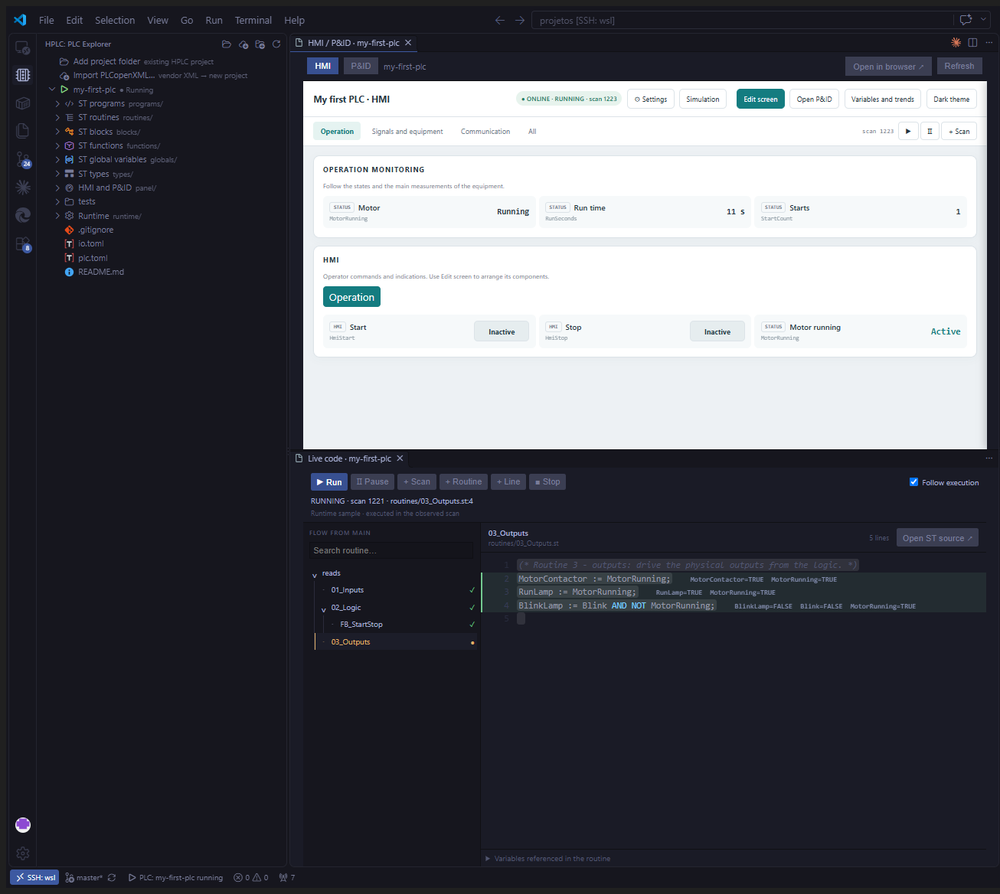

# Getting started

This guide takes you from a fresh install to running and editing your first PLC program,
and then to importing a project from a PLC IDE. Install HPLC first (see the
[README](../README.md#installation)).



## 1. Your first program (starter project)

1. Click the **HPLC** icon in the activity bar.
2. Click **New project…**, choose **Starter project (recommended)**, pick a folder and
   keep the name `my-first-plc`. HPLC creates the project and opens
   `routines/02_Logic.st`.
3. Hover the project in the HPLC view and click **Play** (▶). HPLC compiles the
   program, starts it and opens the HMI above and the live code below.
4. On the HMI, press **Start**. The motor runs, **Run time** counts the seconds and
   **Starts** shows 1. Press **Stop** to stop it.

The starter is a small, complete program:

| File | What it does |
|---|---|
| `programs/Main.st` | the program; it pulls in the routines in order |
| `routines/01_Inputs.st` | Start from the HMI or from the panel door button |
| `routines/02_Logic.st` | start/stop latch, start counter, run-time counter, blink (**write your code here**) |
| `routines/03_Outputs.st` | drives the motor contactor and the lamps |
| `blocks/10_FB_StartStop.st` | a reusable start/stop function block |
| `globals/` | inputs, outputs and HMI variables |
| `panel/panel.json`, `panel/pid.json` | the HMI and P&ID screens |
| `tests/scenarios.yaml` | automatic tests |

### Exercise: stop the motor after 10 seconds

1. In `programs/Main.st`, add a timer to the `VAR` block:

   ```iecst
   AutoStop : TON;                (* stop after 10 s *)
   ```

2. In `routines/02_Logic.st`, replace the `Motor(...)` line with:

   ```iecst
   AutoStop(IN := MotorRunning, PT := T#10S);
   Motor(Start := StartEdge.Q, Stop := HmiStop OR NOT StopButton OR AutoStop.Q);
   ```

3. Press **Play** again. HPLC rebuilds and restarts the program. Press **Start**: the
   motor now stops by itself after 10 s.

If you make a mistake, the error appears in the **Problems** panel at the exact line
and column, with a plain message such as *Unknown name 'Autostp': it is not declared*.
A summary is also printed in the **HPLC** output.

### Watch and debug

- In the live code, the lines run in the last scan are highlighted, and the current
  values appear next to the code. Use **Pause**, **+ Scan**, **+ Routine** and
  **+ Line** to step through the program.
- On the HMI, **Variables and trends** lists every variable. Click a value to write it,
  and star a variable to plot it.
- To add a value to the screen, click **Edit screen**, drag a tag onto an area and save.

## 2. Your first import (PLCopenXML)

You can try the import without a PLC: download the sample
[`water-tank-sample.xml`](https://raw.githubusercontent.com/FelipeHornink/HPLC/master/examples/plcopen/water-tank-sample.xml).
With your own project, export it from the IDE first:
- in CODESYS or MasterTool, right-click the **Application** node and choose
  *Export PLCopenXML*;
- or use *Project › Export PLCopenXML*.

1. In the HPLC view, click **Import PLCopenXML…**.
2. **Step 1 of 2:** choose the XML file.
3. **Step 2 of 2:** choose where to create the converted project. The suggested name is
   the XML file name.
4. HPLC converts the project and opens the import report (`plcopen/IMPORT_REPORT.md`).
   Read it. It lists:
   - Ladder and FBD POUs that were converted to ST;
   - vendor library types the simulation does not know, such as hardware diagnostics;
   - every adaptation made only for the simulator.
5. Press **Play**. HPLC generates starting HMI and P&ID screens from the variables;
   adjust them with **Edit screen**.

Your ST sources keep the vendor's form, so you can copy routines back into the IDE.

## 3. Exporting back

Click **Export** on the project row:

- **Full export** writes the vendor XML back, edited only where you changed something.
  Import it into the **same** project in the IDE. Use this one for projects you
  imported.
- **Logic only** writes `_Application.xml` and one `.st` per POU. Use it for any IEC
  IDE: in CODESYS or MasterTool, select the **Application** node before importing.

Each export goes to its own folder, `export/<date>_<full|logic>/`. Details are in
[EXPORTING.md](EXPORTING.md).

## 4. Next steps

- Use an AI assistant (Claude Code, Codex…) on the project folder: ask it to explain the
  logic, write test scenarios or review interlocks. See
  [Working with an AI assistant](../README.md#working-with-an-ai-assistant-recommended).
- Look at [`examples/water-tank`](../examples/water-tank) for a bigger example with
  analog values, alarms, a state machine and a simulated process.
